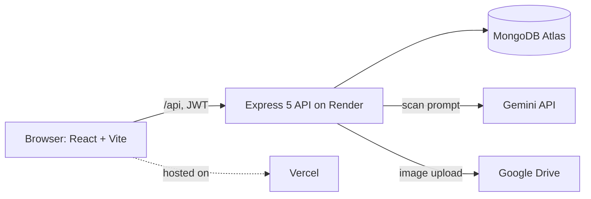
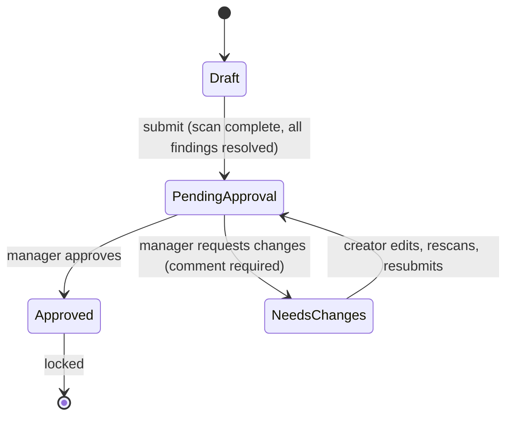

# Architecture

## Overview

The client calls the API at `https://brandguard-ai-3br0.onrender.com/api` in production and `/api` (Vite proxy) in development. In a production-style local run Express serves the built client.

## Backend layout

| Folder | Role |
|---|---|
| `server/routes` | URL to controller mapping, with `authenticate` and `authorizeRoles` |
| `server/controllers` | Business rules: drafts, findings, auth, catalog (rules and facts), audit, organisations |
| `server/services/geminiService.js` | Calls Gemini, retries, model fallback, response checks |
| `server/services/scanPolicy.js` | Plain-code checks: rule phrases, alt-text, positive claims |
| `server/services/auditService.js` | Writes audit records |
| `server/models` | Mongoose schemas |

## Data model (7 collections)

| Collection | Key fields | Notes |
|---|---|---|
| `Organisation` | name | Tenant |
| `User` | name, email, password (hash), role, tokenVersion, organisationId | Roles: creator, reviewer, manager, admin |
| `Draft` | organisationId, author, title, channel, content, originalContent, revisions[], hasImage, altText, findings[], findingsCount, scanStatus, scannedAt, status, reviewedBy, reviewComment | **Findings are an embedded array.** Status: Draft, Pending Approval, Needs Changes, Approved |
| `RulebookEntry` | organisationId, title, description, status | Separate collection |
| `Fact` | organisationId, title, owner, validUntil, status | Separate collection |
| `AuditLog` | organisationId, draft, user, action, comment, previousStatus, newStatus, metadata | Also holds review comments |
| `Scan` | fileName, driveUrl, geminiAnalysis, modelUsed | Image scan history; **has no organisationId** (see limitations) |

## Draft status flow

Editing content resets findings and returns the draft to Draft status. Status changes use atomic updates so two reviewers cannot both decide.

## Who can do what (as implemented)

| Action | Creator | Reviewer | Manager | Admin |
|---|---|---|---|---|
| Create, edit, scan, submit own draft; resolve findings | Yes | No | No | No |
| List and open drafts | Own only | No (route blocks it) | Submitted only | Submitted only |
| Comment on a submitted draft | No | No | Yes | Yes |
| Approve or request changes | No | No | Yes | No (route allows, controller refuses) |
| Manage rules and facts | No | No | Yes | Yes |
| Read audit log | No | Yes | Yes | Yes |
| Create organisation | No | No | No | Yes |

## Scan pipeline

1. Load the organisation's active rules and facts.
2. Plain-code checks: rule phrases (`must not contain` / `must include`), alt-text length and generic words, positive-claim checks.
3. Gemini call with the draft, rules and facts; JSON output required. Up to 2 attempts per model, falling back through a list of models. 30 second timeout.
4. Response checks: valid JSON, every finding has a type, an explanation and a `quote` that appears word for word in the draft; if a fact or rule ID is given it must exist in the supplied list.
5. Plain-code findings come first; duplicate AI findings are removed.
6. If Gemini fails or returns unusable output, the plain-code findings are returned with `scanStatus: partial` and a warning. A partial scan cannot be submitted.

The citation check is part of `geminiService.parseGeminiResponse`; it is not a separate service.

## Image scan

`POST /api/upload-and-scan` accepts up to 5 files, uploads each to Google Drive, sends it to Gemini with a general brand-compliance prompt, and stores the result in `Scan`.
